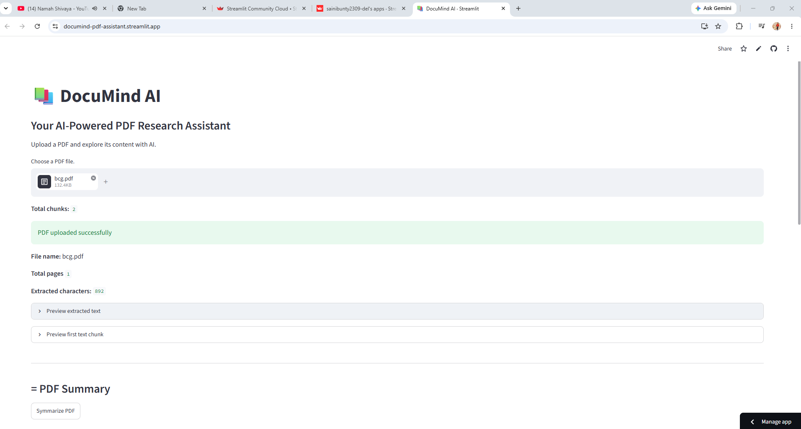
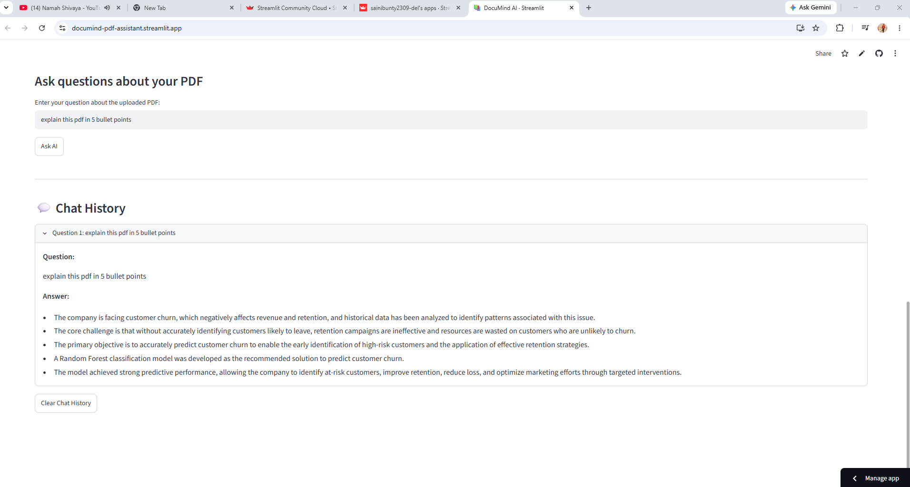

# 📚 DocuMind AI — RAG-Based PDF Research Assistant

DocuMind AI is an AI-powered PDF research assistant that allows users to upload a PDF, ask questions about its content, retrieve relevant passages, and generate concise summaries using a Large Language Model (LLM).

The project uses Retrieval-Augmented Generation (RAG) to find relevant document chunks before generating answers.

## 🚀 Live Demo

Try DocuMind AI here: **[Open Live App](https://documind-pdf-assistant.streamlit.app/)**

## 📸 Screenshots

### App Interface


### AI Question Answering


### PDF Summarization


## ✨ Features

- 📄 PDF upload and text extraction
- ✂️ Text chunking with overlap
- 🔎 Semantic search using text embeddings
- 🤖 Context-based question answering using the Groq API
- 📍 Relevant source passages with PDF page numbers
- 📝 PDF summarization
- 💬 Chat history during the current session
- ⚡ Cached document embeddings

## 🛠️ Tech Stack

- Python
- Streamlit
- FastEmbed
- NumPy
- PyPDF
- Groq API
- python-dotenv

## 🧠 How It Works

1. Upload a PDF document.
2. Extract readable text from its pages.
3. Split the extracted text into smaller overlapping chunks.
4. Generate embeddings for the chunks.
5. Convert the user's question into an embedding.
6. Retrieve the most relevant chunks using cosine similarity.
7. Send the selected context to the Groq LLM.
8. Display the answer along with relevant source passages and page numbers.

## ⚙️ Installation and Setup

### 1. Clone the repository

```bash
git clone https://github.com/sainibunty2309-del/DocuMind-AI.git
cd DocuMind-AI
```

### 2. Create and activate a virtual environment

```bash
python -m venv .venv
```

Windows PowerShell:

```powershell
.venv\Scripts\Activate.ps1
```

### 3. Install dependencies

```bash
pip install -r requirements.txt
```

### 4. Configure the API key

Create a `.env` file in the project root:

```text
GROQ_API_KEY=your_groq_api_key_here
```

Replace the placeholder with your own Groq API key. Never commit your real API key to GitHub.

### 5. Run the application

```bash
python -m streamlit run app.py
```

## ⚠️ Limitations

- Text extraction may not work on scanned PDFs without OCR.
- Answers depend on the quality of extracted text and retrieved chunks.
- Long documents may require more advanced retrieval and summarization strategies.
- The chat history is session-based and is not stored permanently.

## 🔮 Future Improvements

- Support for multiple PDF documents
- Persistent chat history
- OCR support for scanned PDFs
- Improved retrieval and reranking
- Deployment with Streamlit Community Cloud

## 👨‍💻 Author

**Bunty Saini**

Add your GitHub and LinkedIn profile links here.
